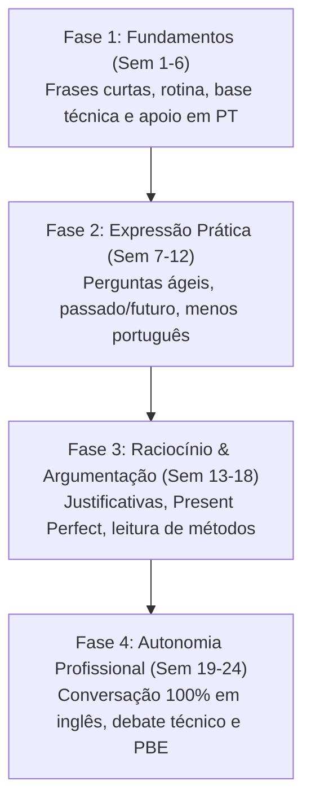

# 🎙️ Fluência em Inglês com IA (15 Min/Dia) • Framework Open-Source

[](LICENSE)
[]()
[]()
[]()
[]()

Um framework estruturado, reprodutível e open-source para destravar a fluência em língua inglesa e o domínio da literatura técnica internacional em **24 semanas**, com apenas **15 minutos diários de chamada de voz** com Inteligência Artificial, repetição espaçada, integração com o **PubMed** e **dashboards interativos** de evolução.

---

## 🎯 Por Que Esse Método Funciona?

A maioria dos cursos tradicionais de inglês falha por dois motivos: **excesso de tempo exigido** (aulas longas que geram cansaço e abandono) e **falta de conexão com a prática real** da profissão do aluno.

Este projeto resolve ambos os problemas através de 4 pilares:

1. **Adesão Diária Absoluta (15 Minutos/Dia):** 15 minutos é sustentável mesmo na rotina mais puxada de estudos ou trabalho. Em 24 semanas, são **144 sessões ativas de fala**, sem quebrar a consistência.
2. **Regra 80/20 & Pingue-Pongue:** O aluno fala 80% do tempo. O professor de IA não faz monólogos; ele faz perguntas abertas e simulações curtas.
3. **Espelhamento Imediato:** Quando o aluno erra, o professor repete a **frase inteira correta**, permitindo memorizar a estrutura no contexto em vez de regras soltas.
4. **Baseado em Evidências (PubMed Real):** Sextas e sábados são dedicados a abstracts e artigos científicos reais da área do aluno (usando ferramentas automatizadas de busca acadêmica).

---

## 🧭 Rotina Semanal Padrão (Segunda a Sábado)

| Dia | Foco Pedagógico | Descrição Prática |
| :--- | :--- | :--- |
| **Segunda** | Cotidiano & Agilidade | Conversação rápida, situações cotidianas, escuta e resposta ágil. |
| **Terça** | Gramática Comunicativa | Um ponto gramatical comparativo por semana (sem decoreba). |
| **Quarta** | Vocabulário Técnico / Área | Termos profissionais, rotina de trabalho/estudo e simulações. |
| **Quinta** | Cotidiano & Phrasal Verbs | Tomada de decisão, debates leves, dilemas práticos. |
| **Sexta** | Artigo Científico - Parte 1 | Leitura de *Abstract* e identificação de objetivos no PubMed. |
| **Sábado** | Artigo Científico - Parte 2 | Métodos, estatística básica e revisão integrada da semana. |
| **Domingo** | Folga Total | Consolidação neurológica e descanso. |

---

## 🗺️ A Jornada em 4 Fases (24 Semanas)



---

## 📂 Arquitetura do Repositório

```text
├── Deivid/                     # Caso real: Estudante de Fisioterapia (UFTM)
│   ├── plano-de-ensino.md      # Plano de 24 semanas adaptado para Reabilitação/Fisio
│   ├── INSTRUCOES-CLAUDE.md    # Prompt do professor para chamada de voz
│   ├── registro-aulas.md       # Diário de bordo sincronizado aula a aula
│   ├── dashboard.html          # Dashboard visual com radar de erros e áudio
│   └── Material/               # Artigos semanais do PubMed e Relatórios
│
├── Rafael/                     # Caso real: Estudante de Medicina
│   ├── plano-de-ensino.md      # Plano focado em Anamnese, SBAR e Artigos Médicos
│   ├── INSTRUCOES-CLAUDE.md    # Prompt com protocolo de diagnóstico inicial
│   ├── registro-aulas.md       # Histórico de aulas
│   ├── dashboard.html          # Dashboard médico interativo
│   └── Material/               # Artigos e Relatórios
│
├── template-aluno/             # 🚀 TEMPLATE PRONTO PARA QUALQUER NOVO ALUNO
│   ├── plano-de-ensino.md      # Modelo personalizável para qualquer profissão
│   ├── INSTRUCOES-CLAUDE.md    # Instruções universais para a IA
│   ├── registro-aulas.md       # Registro limpo pronto para começar
│   ├── dashboard.html          # Dashboard universal personalizável
│   └── Material/               # Pastas de Artigos e Relatórios
│
├── .agents/skills/plano-ingles/
│   └── SKILL.md                # Skill para Antigravity IDE / Agent Kit (busca PubMed e relatórios)
│
├── .gitignore                  # Ignora arquivos de sistema (desktop.ini, etc.)
├── LICENSE                     # Licença MIT Open Source
└── README.md                   # Esta documentação
```

---

## 🚀 Como Começar (Passo a Passo para Novos Alunos)

Qualquer pessoa pode adotar este método em 5 minutos:

### 1. Clonar ou Baixar o Repositório
```bash
git clone https://github.com/deividbsilva2022-design/ingles-imersao-ia.git
cd ingles-imersao-ia
```

### 2. Criar a Pasta do Seu Perfil
Copie a pasta `template-aluno` e renomeie com seu nome (ex: `Marina/`):
```bash
cp -r template-aluno Marina
```

### 3. Personalizar Seu Plano
Abra o arquivo `Marina/plano-de-ensino.md` e preencha:
- Seu nome, profissão/curso (ex: Odontologia, Engenharia, Programação, Psicologia, etc.).
- Seu nível aproximado (A1, A2, B1).
- Seus principais objetivos.

### 4. Realizar a Aula 1 por Chamada de Voz
1. Abra o aplicativo do **Claude** no celular (iOS ou Android) ou no computador.
2. Crie um novo chat ou projeto e cole o conteúdo de `Marina/INSTRUCOES-CLAUDE.md`.
3. Toque no **ícone de fone de ouvido / microfone (chamada de voz)**.
4. Fale com a IA: ela executará automaticamente o **Protocolo de Avaliação Inicial (15 min)**, definirá seu ponto de partida e registrará os resultados!

### 5. Acompanhar a Evolução no Dashboard (Sincronização em Tempo Real)
Abra o arquivo `[Aluno]/dashboard.html` em qualquer navegador (Google Chrome, Safari, Edge, Firefox). Não requer instalação de servidores ou Node.js:
- 🔄 **Sincronização com `registro-aulas.md`:**
  - **No Navegador:** Basta clicar no botão **"📂 Conectar registro-aulas.md"** ou simplesmente **arrastar o arquivo para dentro da janela do navegador**. O painel atualiza instantaneamente (métricas, histórico de aulas, radar de erros e termos)!
  - **Via Terminal / Python:** Execute `python sync_dashboards.py` para injetar os dados atualizados diretamente no HTML. Para monitoramento contínuo em segundo plano enquanto estuda, use `python sync_dashboards.py --watch`.
  - **Via Servidor Local:** Se aberto com VS Code Live Server, o dashboard recarrega automaticamente com `fetch`.
- 🔊 **Pronúncia em tempo real:** Clique nos botões de áudio para ouvir termos técnicos nativos (via Web Speech API).
- 🔍 **Busca Dinâmica:** Pesquise por termos ou traduções instantaneamente.
- 🎯 **Radar de Erros:** Veja quais vícios de linguagem já foram superados e quais estão em treino.

---

## 🤖 Como Utilizar com Diferentes Ferramentas de IA

O ecossistema é agnóstico e compatível com as principais ferramentas do mercado:

### 1. Claude (Mobile App & Desktop por Voz)
- **Papel:** **Professor Particular de Voz**.
- **Como usar:** O Claude App possui recurso nativo de chamada de voz de baixíssima latência. Basta carregar o `INSTRUCOES-CLAUDE.md` como instrução do chat. Ele conduzirá a conversa de 15 minutos em inglês e, nos últimos minutos, fornecerá o resumo para você colar em seu `registro-aulas.md`.

### 2. Antigravity IDE / Agent Kit (Google DeepMind)
- **Papel:** **Analista de Estudos & Automação**.
- **Como usar:** O repositório inclui a skill [.agents/skills/plano-ingles/SKILL.md](.agents/skills/plano-ingles/SKILL.md).
- Comandos prontos no chat do Antigravity:
  - `"prepara o artigo da semana para o Rafael"` → O assistente conecta-se ao servidor MCP `pubmedmcp`, busca artigos científicos reais no PubMed, extrai vocabulário, tradução fonética e salva na pasta `Material/Artigos/`.
  - `"relatório da semana do Deivid"` → Analisa as aulas completadas e gera um relatório pedagógico em `Material/Relatorios/`.

### 3. Cursor / VS Code / Claude Code / Codex
- **Papel:** **Ambiente de Edição & Sincronização**.
- **Como usar:** Abra a pasta no seu editor favorito. Todos os arquivos são formatados em Markdown puro e HTML5 sem dependências externas pesadas.

---

## 📊 Demonstração dos Dashboards Interativos

Cada aluno possui um painel personalizado:

- **Deivid (Fisioterapia):** [Deivid/dashboard.html](Deivid/dashboard.html) — Vocabulário anatômico, termos cinético-funcionais, biomecânica e monitor de fixação de frases clínicas.
- **Rafael (Medicina):** [Rafael/dashboard.html](Rafael/dashboard.html) — Sinais vitais, equipamentos hospitalares, setores de emergência/UTI, modelo IMRAD e técnica SBAR para passagem de plantão.
- **Template Universal:** [template-aluno/dashboard.html](template-aluno/dashboard.html) — Modelo pronto para adaptação a qualquer carreira.

---

## 🤝 Como Contribuir

Contribuições são muito bem-vindas! Se você desenvolveu templates para novas áreas (ex: *Direito Internacional, Engenharia de Software, Arquitetura, Aviação*), envie um Pull Request:

1. Faça um Fork do projeto.
2. Crie uma branch para a sua feature (`git checkout -b feature/novo-template-odontologia`).
3. Faça commit das mudanças (`git commit -m 'feat: template para estudantes de odontologia'`).
4. Faça push para a branch (`git push origin feature/novo-template-odontologia`).
5. Abra um Pull Request.

---

## 📜 Licença

Este projeto é distribuído sob a licença **MIT**. Veja o arquivo [LICENSE](LICENSE) para mais detalhes.

---

*Criado com dedicação por Deivid, Rafael e assistentes de Inteligência Artificial para democratizar o acesso à fluência em inglês técnico e científico.*
